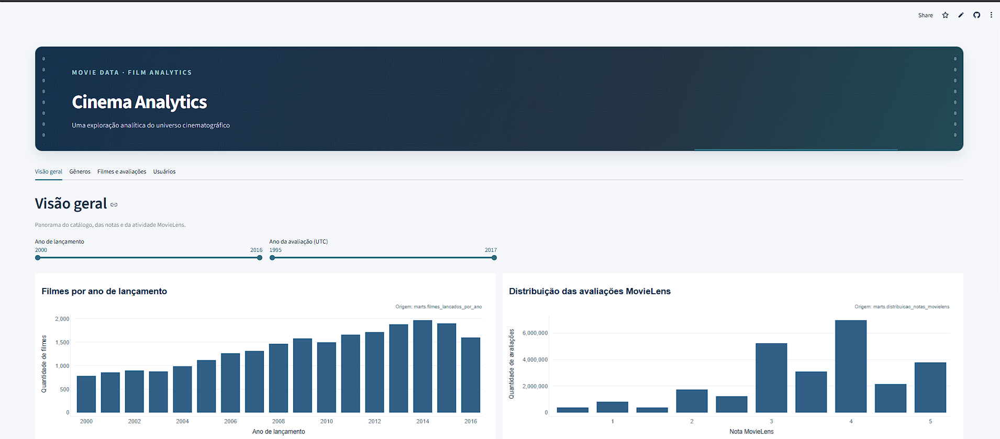
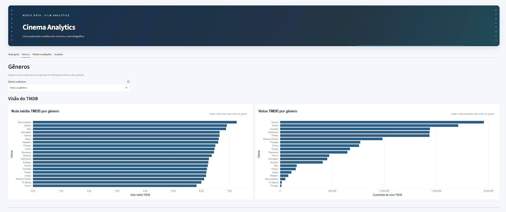
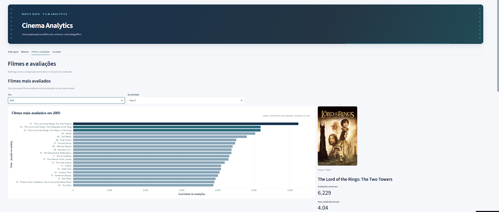
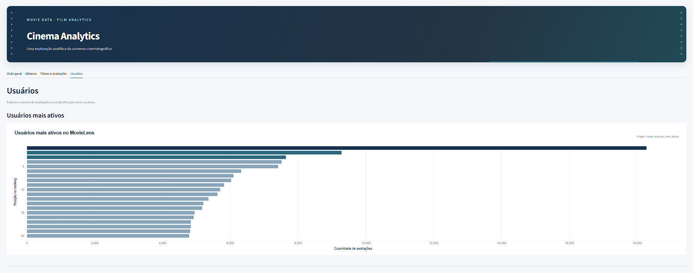
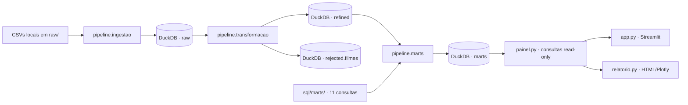

# 🎬 Cinema Analytics — Movie Data Pipeline

**Da exploração de dados cinematográficos a indicadores analíticos interativos**

[](https://movie-data-pipeline-aufci3bj3y77rd7rwijzbu.streamlit.app/)

[](https://robertrossi.github.io/movie-data-pipeline/relatorio.html)

[](https://www.python.org/)


[](https://github.com/robertrossi/movie-data-pipeline/actions/workflows/ci.yml)

## Sumário

- [Acesse o projeto](#acesse-o-projeto)
- [O que o dashboard apresenta](#o-que-o-dashboard-apresenta)
  - [Visão geral](#visao-geral)
  - [Gêneros](#generos)
  - [Filmes e avaliações](#filmes-e-avaliacoes)
  - [Usuários](#usuarios)
- [Capturas do dashboard](#capturas-do-dashboard)
- [Arquitetura](#arquitetura)
  - [Granularidade, chaves e relacionamentos](#granularidade-chaves-e-relacionamentos)
- [Indicadores analíticos](#indicadores-analiticos)
- [Tecnologias](#tecnologias)
- [Executar localmente](#executar-localmente)
- [Relatório HTML](#relatorio-html)
- [Testes e qualidade](#testes-e-qualidade)
- [Integração Contínua (CI)](#integração-contínua-ci)
- [Dados de origem](#dados-de-origem)
- [Documentação e volumes registrados](#documentacao-e-volumes-registrados)
- [Estrutura do projeto](#estrutura-do-projeto)
- [Uso de IA e validação das decisões](#uso-de-ia-e-validacao-das-decisoes)
- [Sobre](#sobre)

O Cinema Analytics transforma metadados de filmes e avaliações MovieLens em dados organizados e indicadores que ajudam a explorar catálogo, gêneros, atividade dos usuários e tendências de avaliação. O pipeline usa Python, SQL e DuckDB para validar e preparar os dados; o resultado aparece em um dashboard interativo e em um relatório HTML estático.

## Acesse o projeto

| Recurso | Acesso | O que oferece |
|---|---|---|
| Dashboard interativo | [Abrir no Streamlit Community Cloud](https://movie-data-pipeline-aufci3bj3y77rd7rwijzbu.streamlit.app/) | Quatro abas, filtros, rankings, gráficos e pôsteres quando disponíveis. |
| Relatório analítico | [Abrir relatório HTML](https://robertrossi.github.io/movie-data-pipeline/relatorio.html) | Quatro seções e 14 gráficos Plotly; relatório estático, sem filtros, seletores ou pôsteres. |
| Código e documentação | [Ver repositório no GitHub](https://github.com/robertrossi/movie-data-pipeline) | Pipeline, SQL, testes e documentação metodológica. |

## O que o dashboard apresenta

O dashboard reúne quatro perspectivas complementares sobre o catálogo TMDB e as avaliações MovieLens.

### Visão geral

Mostra filmes por ano de lançamento, distribuição das notas MovieLens, volume de avaliações ao longo do tempo e nota média anual. Os controles permitem selecionar intervalos de anos de lançamento e de avaliação em UTC.

### Gêneros

Compara a nota média e os votos TMDB por gênero com as notas MovieLens por gênero. O seletor destaca um gênero sem retirar as outras categorias da comparação.

### Filmes e avaliações

Apresenta o ranking anual dos filmes mais avaliados (Top 10 ou Top 20), o destaque do primeiro colocado com avaliações, nota média e pôster quando disponível, o ranking histórico, a comparação entre dois anos e a evolução das avaliações.

### Usuários

Mostra os usuários com mais avaliações, a distribuição da atividade por faixas e uma tabela detalhada com usuários por faixa.

**Leitura das métricas:** notas TMDB vêm dos metadados do catálogo; notas MovieLens são avaliações submetidas por usuários. São medidas diferentes e não devem ser interpretadas como uma única nota.

## Capturas do dashboard

As capturas abaixo apresentam as quatro áreas do dashboard.

### Visão geral



### Gêneros



### Filmes e avaliações



### Usuários



## Arquitetura



| Camada | Responsabilidade |
|---|---|
| `raw` | Tabelas carregadas dos CSVs, preservando valores de origem como texto. |
| `refined` | Filmes, avaliações e links convertidos, tipados e validados. |
| `rejected` | Filmes rejeitados pelas regras de qualidade, com origem e motivo. |
| `marts` | 11 tabelas analíticas construídas pelas consultas SQL versionadas. |

### Granularidade, chaves e relacionamentos

| Tabela | O que representa uma linha | Chaves e observações |
|---|---|---|
| `raw.filmes` | Um registro de filme lido de `movies_metadata.csv`. | `id` pode se repetir na origem; não é tratado como chave única nesta camada. |
| `raw.avaliacoes` | Uma avaliação de um usuário para um filme. | A combinação (`userId`, `movieId`) foi verificada e é validada como única na transformação. |
| `raw.links` | Um mapeamento entre identificadores MovieLens e identificadores externos. | `movieId` é validado como único; `tmdbId` pode ser nulo ou aparecer em mais de uma linha. |
| `raw.creditos` | Um registro de créditos associado a um filme, conforme a linha do CSV. | Ingerida como texto; não participa da transformação refined atual. |
| `raw.palavras_chave` | Um registro de palavras-chave associado a um filme, conforme a linha do CSV. | Ingerida como texto; não participa da transformação refined atual. |
| `refined.filmes` | Um filme convertido e aceito pelas regras de qualidade. | `id` não pode ser nulo; duplicatas idênticas são reduzidas a uma ocorrência. Todas as ocorrências dos 13 IDs divergentes e os três registros malformados são rejeitados. |
| `refined.avaliacoes` | Uma avaliação MovieLens com tipos convertidos. | Uma linha por (`userId`, `movieId`); duplicidade nessa combinação bloqueia a publicação. `timestamp` permanece Unix em segundos. |
| `refined.links` | Um relacionamento MovieLens–TMDB/IMDb tipado. | Uma linha por `movieId`; `tmdbId` repetido e nulo é permitido. |
| `rejected.filmes` | Uma ocorrência de filme retirada de `refined.filmes` pelas regras documentadas. | Mantém os valores originais e registra `source_table`, `source_rowid` e `rejection_reason`; `source_rowid` é localizador físico, não chave permanente nem número da linha CSV. |

O relacionamento entre avaliações e metadados passa por `movieId` em `refined.links` e `tmdbId` em `refined.filmes.id`. Esse vínculo pode estar ausente; `tmdbId` não é único. Portanto, indicadores que cruzam essas tabelas aplicam os critérios descritos nas respectivas consultas e podem excluir registros sem correspondência completa. As regras não declaram chaves primárias formais para as tabelas.

O pipeline é organizado em `pipeline/ingestao.py` (CSV para `raw`), `pipeline/transformacao.py` (`raw` para `refined` e `rejected`) e `pipeline/marts.py` (consultas SQL para `marts`). A ingestão valida os cinco arquivos antes de abrir o banco e importa as colunas como texto; somente campos vazios viram nulos. A transformação valida conversões e chaves, remove duplicatas idênticas de filmes e publica `refined` e `rejected` em uma transação. Os arquivos `credits.csv` e `keywords.csv` são ingeridos, mas não participam da transformação refined atual.

Sem `--only`, a publicação substitui o schema `marts` dentro de uma transação. Com `--only NN ...`, atualiza apenas os indicadores escolhidos e preserva as demais tabelas. O módulo `painel.py` consulta as MARTs em modo somente leitura; `app.py` fornece a interface Streamlit e `relatorio.py` gera o HTML.

O banco local padrão é `movie_data.duckdb`, na raiz do projeto. No Community Cloud, `pipeline/db.py` seleciona o snapshot em `data/movie_data_snapshot.duckdb`; `MOVIE_DATA_DB_PATH` permite configurar explicitamente outro caminho. O snapshot contém as tabelas necessárias ao dashboard e não substitui o banco completo para executar ingestão e transformação.

## Indicadores analíticos

As 11 MARTs respondem a perguntas de negócio sobre catálogo, avaliações e atividade dos usuários.

| Nº | MART / consulta SQL | Grão e métrica principal | Pergunta que ajuda a responder |
|---:|---|---|---|
| 01 | `filmes_lancados_por_ano` — [`01_filmes_lancados_por_ano.sql`](sql/marts/01_filmes_lancados_por_ano.sql) | Ano de lançamento; contagem de filmes entre 2000 e 2016. | Como se distribui a quantidade de filmes lançados? |
| 02 | `nota_media_tmdb_por_genero` — [`02_nota_media_tmdb_por_genero.sql`](sql/marts/02_nota_media_tmdb_por_genero.sql) | Gênero; contagem de filmes e média simples de `vote_average` para filmes com pelo menos 50 votos. | Quais gêneros têm as maiores notas médias TMDB? |
| 03 | `quantidade_votos_tmdb_por_genero` — [`03_quantidade_votos_tmdb_por_genero.sql`](sql/marts/03_quantidade_votos_tmdb_por_genero.sql) | Gênero; contagem de filmes e soma de `vote_count`. | Como os votos TMDB se distribuem entre os gêneros? |
| 04 | `distribuicao_notas_movielens` — [`04_distribuicao_notas_movielens.sql`](sql/marts/04_distribuicao_notas_movielens.sql) | Valor de `rating`; contagem e percentual das avaliações. | Como as avaliações MovieLens se distribuem por nota? |
| 05 | `avaliacoes_movielens_ao_longo_do_tempo` — [`05_avaliacoes_movielens_ao_longo_do_tempo.sql`](sql/marts/05_avaliacoes_movielens_ao_longo_do_tempo.sql) | Ano UTC da avaliação; contagem de avaliações. | Como varia o volume de avaliações por ano? |
| 06 | `nota_media_movielens_ao_longo_do_tempo` — [`06_nota_media_movielens_ao_longo_do_tempo.sql`](sql/marts/06_nota_media_movielens_ao_longo_do_tempo.sql) | Ano UTC da avaliação; volume e média de `rating`. | Como evoluem o volume e a nota média anual? |
| 07 | `filmes_mais_avaliados_movielens` — [`07_filmes_mais_avaliados_movielens.sql`](sql/marts/07_filmes_mais_avaliados_movielens.sql) | `movieId`; contagem e média das notas, Top 20 histórico. | Quais filmes concentram mais avaliações no conjunto? |
| 08 | `usuarios_mais_ativos` — [`08_usuarios_mais_ativos.sql`](sql/marts/08_usuarios_mais_ativos.sql) | `userId`; contagem e média das notas, Top 20. | Quais usuários registraram mais avaliações? |
| 09 | `distribuicao_avaliacoes_por_usuario` — [`09_distribuicao_avaliacoes_por_usuario.sql`](sql/marts/09_distribuicao_avaliacoes_por_usuario.sql) | Faixa de avaliações por usuário; número de usuários e percentual. | Como os usuários se distribuem por volume de atividade? |
| 10 | `nota_media_movielens_por_genero` — [`10_nota_media_movielens_por_genero.sql`](sql/marts/10_nota_media_movielens_por_genero.sql) | Gênero; filmes, volume de avaliações e média ponderada das notas MovieLens. | Como se comparam as notas por gênero, considerando o volume avaliado? |
| 11 | `filmes_mais_avaliados_movielens_por_ano` — [`11_filmes_mais_avaliados_movielens_por_ano.sql`](sql/marts/11_filmes_mais_avaliados_movielens_por_ano.sql) | Ano UTC e `movieId`; contagem, média e posição anual. | Quais filmes lideram o volume de avaliações em cada ano? |

As regras detalhadas, fontes, granularidade e ressalvas estão em [`indicadores.md`](indicadores.md) e nos arquivos de [`sql/marts/`](sql/marts/).

### Cuidados de interpretação

- Os indicadores TMDB descrevem os metadados disponíveis no dataset, não necessariamente o universo mundial de filmes ou espectadores.
- Os indicadores MovieLens representam avaliações registradas na base, não o comportamento de todos os espectadores.
- Filmes multigênero participam de cada gênero associado; totais entre gêneros não são aditivos.
- O indicador 02 calcula média simples das notas TMDB para filmes elegíveis; não pondera pelo número de votos.
- O indicador 10 calcula média MovieLens ponderada pelo volume de avaliações dos filmes associados a cada gênero. Filmes sem vínculo completo ou gênero identificável ficam fora da agregação.
- O indicador 11 agrupa por `movieId` e ano UTC da avaliação, não pelo ano de lançamento. Empates são ordenados por `movieId` crescente.

## Tecnologias

| Área | Tecnologia e versão registrada |
|---|---|
| Linguagem | Python 3.13.5 no ambiente usado na validação; projeto requer Python `>=3.13`. |
| Banco analítico | DuckDB 2.0.0 (versão resolvida em `uv.lock`). |
| Dados e gráficos | pandas 3.1.0, Plotly 7.1.0. |
| Aplicação | Streamlit 1.66.1. |
| Ambiente | uv; versões de dependências registradas em `uv.lock`. |
| Testes e estilo | pytest 9.2.0, pytest-cov 7.1.0 e Ruff 0.17.3. |

## Executar localmente

### Pré-requisitos

- Python 3.13 ou superior compatível com as dependências do projeto.
- [uv](https://docs.astral.sh/uv/).
- Os cinco CSVs de origem listados em [Dados de origem](#dados-de-origem), disponibilizados em `raw/`.

### Instalar e preparar os dados

```powershell
git clone https://github.com/robertrossi/movie-data-pipeline.git
cd movie-data-pipeline
uv sync
```

Os dados de origem não são distribuídos neste repositório. Obtenha-os conforme a seção [Dados de origem](#dados-de-origem) e coloque em `raw/` os arquivos exigidos pelo script de ingestão.

| Arquivo | Tabela criada em `raw` | Conteúdo |
|---|---|---|
| `movies_metadata.csv` | `raw.filmes` | Metadados dos filmes, incluindo título, gêneros e lançamento. |
| `ratings.csv` | `raw.avaliacoes` | Avaliações feitas por usuários MovieLens. |
| `links.csv` | `raw.links` | Identificadores MovieLens e externos. |
| `credits.csv` | `raw.creditos` | Informações de elenco e equipe. |
| `keywords.csv` | `raw.palavras_chave` | Palavras-chave associadas aos filmes. |

`credits.csv` e `keywords.csv` são ingeridos em `raw`, mas não participam da transformação `refined` atual. `ratings_small.csv` e `links_small.csv` não são exigidos pelo pipeline.

### Executar o pipeline

Execute as etapas na ordem indicada:

> **Atenção:** a ingestão substitui as tabelas `raw` correspondentes; a transformação substitui `refined` e `rejected`; a publicação completa das MARTs substitui o schema `marts`. Confira o caminho do banco configurado e preserve uma cópia dos dados antes de executar essas etapas em um banco existente.

```powershell
uv run python -m pipeline.ingestao
uv run python -m pipeline.transformacao
uv run python -m pipeline.marts
```

A publicação completa substitui o schema `marts` em uma transação. Para atualizar somente alguns indicadores, por exemplo:

```powershell
uv run python -m pipeline.marts --only 05 06
```

### Iniciar o dashboard

Depois de publicar as MARTs:

```powershell
uv run streamlit run app.py
```

Localmente, o dashboard usa `movie_data.duckdb` em modo somente leitura. Na hospedagem, usa o snapshot do caminho `data/movie_data_snapshot.duckdb`.

## Relatório HTML

Gere e abra o relatório estático com:

```powershell
uv run python relatorio.py
Start-Process .\relatorio.html
```

O relatório apresenta quatro seções e 14 gráficos Plotly, com IDs estáveis e carregamento único da biblioteca via CDN. O hover dos gráficos continua disponível, mas filtros, seletores e pôsteres pertencem ao dashboard e não aparecem no HTML.

## Testes e qualidade

Execute a suíte e as verificações de estilo com:

```powershell
uv run pytest --cov
uv run ruff check .
uv run ruff format --check .
```

Na validação registrada em 03/11/2026, **75 testes passaram** e a cobertura total foi **94%**. A execução de referência durou **23,92 segundos**, com Python 3.13.5 e duas advertências. `uv run` não funcionou devido à configuração local do pyenv; a suíte foi executada por uma alternativa local já disponível, que usou Plotly 5.24.1 do ambiente Anaconda em vez da versão 7.1.0 resolvida em `uv.lock`. Portanto, a suíte não foi validada no ambiente exato do lockfile. Ruff check e Ruff format check foram executados pelos binários disponíveis e passaram. A cobertura configurada inclui `pipeline/db.py`, `pipeline/ingestao.py`, `pipeline/marts.py`, `pipeline/snapshot.py`, `pipeline/transformacao.py`, `painel.py` e `relatorio.py`; a interface visual `app.py` não entra nessa métrica.

| Módulo medido | Cobertura na validação registrada |
|---|---:|
| `pipeline/db.py` | 100% |
| `pipeline/ingestao.py` | 96% |
| `pipeline/marts.py` | 90% |
| `pipeline/snapshot.py` | 96% |
| `pipeline/transformacao.py` | 90% |
| `painel.py` | 97% |
| `relatorio.py` | 96% |

## Integração Contínua (CI)

O GitHub Actions executa automaticamente os testes e as verificações de qualidade em Pull Requests direcionados à branch `main`. O workflow `.github/workflows/ci.yml` usa Ubuntu 24.04, Python 3.13.5 e uv 0.13.6, com permissão `contents: read`.

As etapas são executadas nesta ordem:

1. Instalar as dependências travadas: `uv sync --locked --all-groups`.
2. Executar os testes e gerar cobertura: `uv run --locked pytest --cov`.
3. Verificar o lint: `uv run --locked ruff check .`.
4. Verificar a formatação: `uv run --locked ruff format --check .`.

A primeira execução do workflow, após a integração pelo PR #16, foi concluída com sucesso em 51 segundos.

## Dados de origem

O conjunto de referência é [The Movies Dataset — Rounak Banik (Kaggle)](https://www.kaggle.com/datasets/rounakbanik/the-movies-dataset). A página do Kaggle informa licença **CC0** para a publicação do dataset. Essa declaração da página não confirma, por si só, os direitos ou condições aplicáveis a todos os dados de terceiros nela reunidos.

O projeto utiliza dados associados ao TMDB e ao MovieLens/GroupLens e não é proprietário dessas fontes. As condições oficiais variam conforme a origem e o uso: consulte as informações do [TMDB](https://developer.themoviedb.org/docs/faq) e do [GroupLens](https://grouplens.org/datasets/movielens/). A versão exata e as condições de redistribuição dos componentes upstream incluídos no arquivo Kaggle não foram confirmadas nesta documentação. O repositório não redistribui os CSVs; obtenha-os na página do Kaggle e verifique as condições aplicáveis antes de reutilizá-los.

## Documentação e volumes registrados

- [`indicadores.md`](indicadores.md): definições, regras e limitações dos indicadores.
- [`specs/transformacao.md`](specs/transformacao.md): especificação da transformação.
- [`sql/marts/`](sql/marts/): consultas SQL que constroem as 11 MARTs.
- [`docs/`](docs/): evidências de transformação e auditorias metodológicas.

Os seguintes volumes constam nas especificações e evidências do projeto; são valores documentados, não uma execução realizada ao revisar este README:

| Tabela | Linhas documentadas |
|---|---:|
| `raw.filmes` | 45.466 |
| `raw.avaliacoes` | 26.024.289 |
| `raw.links` | 45.843 |
| `refined.filmes` | 45.420 |
| `rejected.filmes` | 29 |

A transformação documentada preserva as 26.024.289 avaliações e os 45.843 links. Os filmes rejeitados incluem registros malformados e ocorrências de IDs com duplicidade divergente; duplicatas integralmente idênticas são removidas de `refined.filmes`.

## Estrutura do projeto

```text
.
├── .streamlit/config.toml
├── app.py
├── data/movie_data_snapshot.duckdb  # snapshot para o ambiente hospedado
├── indicadores.md
├── painel.py
├── pipeline/
│   ├── db.py
│   ├── ingestao.py
│   ├── marts.py
│   ├── snapshot.py
│   └── transformacao.py
├── raw/                              # CSVs locais, não incluídos
├── relatorio.py
├── relatorio.html
├── specs/transformacao.md
├── sql/marts/                        # consultas 01–11
├── tests/
├── docs/
├── pyproject.toml
└── uv.lock
```

O banco completo `movie_data.duckdb`, os CSVs, ambientes virtuais e caches são recursos locais e não fazem parte da árvore versionada. O snapshot reduzido é destinado à execução do dashboard hospedado; para executar o pipeline completo localmente, disponibilize os CSVs e o banco de trabalho correspondente.

## Uso de IA e validação das decisões

A IA foi utilizada como apoio à implementação e à revisão de código e documentação. Suas respostas e propostas precisam ser confrontadas com a especificação do projeto, as consultas SQL, os testes e os dados observados; uma sugestão não é evidência de que uma regra está correta.

Os registros disponíveis não documentam um episódio concreto em que uma sugestão de IA tenha causado uma regra de negócio ou implementação incorreta. Por isso, não atribuo à IA erros específicos. Há, porém, uma lição de validação registrada em [`docs/evidencias_transformacao.md`](docs/evidencias_transformacao.md): uma comparação inicial de filmes retornou linhas excedentes por multiplicação no relacionamento com IDs duplicados; a consulta foi ajustada para deduplicar a origem, e a comparação então cobriu as 45.420 linhas esperadas sem divergências. A evidência não atribui esse problema à IA.

Nesta revisão, os detalhes de granularidade e relacionamento foram confrontados com o código de ingestão e transformação, as especificações e as consultas SQL. A licença foi descrita com o limite da informação pública disponível, sem presumir que a declaração da página Kaggle resolva os direitos de todos os dados upstream. O repositório não contém um registro detalhado de prompts ou de decisões assistidas por IA; portanto, não é possível reconstruir interações anteriores além do que está documentado nos arquivos do projeto.

## Sobre

Projeto de portfólio em Engenharia de Dados, com foco em ingestão, qualidade, transformação, modelagem analítica, SQL, testes e visualização. As condições de licenciamento do código e dos dados devem ser verificadas nas respectivas fontes; nenhuma licença é presumida neste README.
