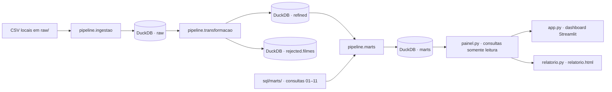

# Cinema Analytics — Movie Data Pipeline

Pipeline de Engenharia de Dados para transformar metadados cinematográficos e avaliações MovieLens em indicadores analíticos DuckDB, apresentados por um dashboard Streamlit e um relatório HTML.

## Acesse o projeto

**Relatório analítico:** [Acessar relatório HTML](https://robertrossi.github.io/movie-data-pipeline/relatorio.html)

O relatório estático apresenta quatro seções e 14 gráficos. Ele não possui filtros interativos, seletores de ano ou gênero, nem pôsteres de filmes.

> O projeto é executado localmente. Não é uma plataforma hospedada nem um serviço de produção.

## Sobre o projeto

O Cinema Analytics organiza arquivos CSV em camadas `raw`, `refined` e `marts`. A transformação valida tipos, chaves e duplicidades; registros de filmes que atendem às regras de rejeição são isolados em `rejected.filmes`. As MARTs alimentam análises separadas para métricas TMDB e avaliações MovieLens.

O repositório contém um dashboard interativo em Streamlit, um relatório HTML com gráficos Plotly, testes automatizados e documentação metodológica. Os dados de origem não são incluídos neste README; é necessário obtê-los separadamente e posicioná-los em `raw/`.

## Tecnologias

**Pipeline e análise:** Python 3.13.5, DuckDB, SQL, pandas, Plotly e Streamlit.

**Ambiente e qualidade:** uv, pytest, pytest-cov e Ruff.

As versões resolvidas estão registradas em `uv.lock`.

## Arquitetura



- **`raw`** guarda as tabelas carregadas dos CSVs, sem conversões de tipos da etapa refined.
- **`refined`** contém filmes, avaliações e links validados e tipados.
- **`rejected`** guarda os registros de filmes rejeitados, com origem e motivo.
- **`marts`** contém tabelas agregadas pelas consultas SQL versionadas.
- **Dashboard e relatório** leem as MARTs já publicadas no banco local.

O banco DuckDB padrão é `movie_data.duckdb`, na raiz do projeto. As consultas do painel usam conexão somente leitura.

## Pipeline de dados

| Módulo | Responsabilidade |
|---|---|
| `pipeline/db.py` | Localiza `raw/` e o banco, abre conexões, cria schemas e substitui tabelas a partir de DataFrames. |
| `pipeline/ingestao.py` | Confere os cinco CSVs obrigatórios antes de abrir o banco e os carrega em `raw` como texto; somente campos vazios são interpretados como nulos. |
| `pipeline/transformacao.py` | Transforma `raw.filmes`, `raw.avaliacoes` e `raw.links`; valida conversões e chaves, remove duplicatas idênticas de filmes e publica refined/rejected em uma transação. |
| `sql/marts/` | Mantém as 11 consultas analíticas; regras de negócio e agregações estão nos arquivos SQL. |
| `pipeline/marts.py` | Descobre e executa as consultas e publica as tabelas `marts` em uma transação. |

`raw.creditos` e `raw.palavras_chave` são ingeridas, mas não fazem parte da transformação refined atual. `ratings_small.csv` e `links_small.csv` estão presentes entre os dados locais, mas não são exigidos pelo script de ingestão.

Sem `--only`, a publicação substitui o schema `marts` inteiro dentro da transação. Com `--only NN ...`, atualiza apenas os indicadores selecionados e preserva as demais tabelas MART.

## Indicadores analíticos

As fontes e regras detalhadas estão em [`indicadores.md`](indicadores.md) e nos arquivos [`sql/marts/`](sql/marts/).

| Nº | Indicador | Objetivo e dimensão/métrica principal |
|---:|---|---|
| 01 | Filmes lançados por ano (TMDB) | Contar filmes por ano de lançamento entre 2000 e 2016. |
| 02 | Nota média TMDB por gênero | Comparar a média simples de `vote_average` por gênero, incluindo filmes com pelo menos 50 votos TMDB. |
| 03 | Votos TMDB por gênero | Somar `vote_count` por gênero; filmes multigênero contribuem em mais de um grupo. |
| 04 | Distribuição das avaliações MovieLens | Contar ratings e calcular seu percentual por valor de nota. |
| 05 | Avaliações MovieLens ao longo do tempo | Contar ratings por ano UTC de registro. |
| 06 | Nota média MovieLens ao longo do tempo | Calcular volume e média dos ratings por ano UTC. |
| 07 | Filmes mais avaliados MovieLens | Ordenar filmes MovieLens por quantidade de ratings; a média é complementar. |
| 08 | Usuários mais ativos | Ordenar usuários pela quantidade de ratings; a média é complementar. |
| 09 | Distribuição de avaliações por usuário | Contar usuários em sete faixas de volume de avaliações e calcular percentuais. |
| 10 | Nota média MovieLens por gênero | Calcular média ponderada pelo volume de ratings dos filmes associados a cada gênero. |
| 11 | Filmes mais avaliados por ano MovieLens | Ranquear cada `movieId` por ano UTC de avaliação; desempate por `movieId` crescente. |

**TMDB e MovieLens são métricas distintas.** As notas TMDB vêm dos metadados do catálogo; as notas MovieLens são ratings submetidos pelos usuários. Em indicadores por gênero, filmes multigênero participam integralmente de cada gênero, então totais entre gêneros não são aditivos. O indicador 10 depende de correspondência entre avaliações, links e metadados e não inclui filmes sem vínculo completo ou sem gênero extraível.

## Dashboard

Execute com `uv run streamlit run app.py`. O dashboard possui quatro abas:

1. **Visão geral:** filmes por ano, distribuição de ratings, quantidade de avaliações e nota média por ano; filtros de ano de lançamento e ano UTC de avaliação.
2. **Gêneros:** nota e votos TMDB, nota MovieLens e seletor para destacar um gênero sem remover os demais da comparação.
3. **Filmes e avaliações:** ranking anual (Top 10 ou 20), destaque do primeiro colocado com quantidade de avaliações, nota e pôster; ranking histórico, comparação entre dois anos e séries temporais com intervalo UTC.
4. **Usuários:** ranking dos mais ativos, distribuição por faixa e tabela detalhada de usuários por faixa.

Os pôsteres são obtidos do servidor de imagens TMDB. O dashboard usa cache de seis horas e mostra um fallback quando a imagem não está disponível.

## Relatório HTML

`relatorio.py` gera `relatorio.html` na raiz do projeto. O relatório apresenta quatro seções e 14 gráficos Plotly, atribui IDs estáveis aos gráficos e carrega a biblioteca Plotly uma vez via CDN. Os gráficos preservam interações como hover, mas o HTML não oferece os filtros dinâmicos e controles do dashboard Streamlit; seus valores são definidos durante a geração.

```powershell
uv run python relatorio.py
Start-Process .\relatorio.html
```

## Estrutura do projeto

```text
.
├── .streamlit/config.toml       # tema Streamlit
├── app.py                       # dashboard
├── indicadores.md               # definição dos indicadores
├── painel.py                    # consultas DuckDB e gráficos Plotly
├── pipeline/
│   ├── db.py                    # conexões e gravação
│   ├── ingestao.py              # CSV → raw
│   ├── transformacao.py         # raw → refined/rejected
│   └── marts.py                 # publicação das MARTs
├── raw/                         # CSVs locais, não incluídos na árvore
├── relatorio.html               # relatório gerado
├── relatorio.py                 # geração do relatório HTML
├── specs/transformacao.md       # especificação da transformação
├── sql/marts/                   # consultas SQL 01–11
├── tests/                       # testes automatizados
├── docs/                        # evidências e auditorias metodológicas
├── pyproject.toml               # dependências e configurações
└── uv.lock                      # versões resolvidas
```

O arquivo local `movie_data.duckdb`, os CSVs, ambientes virtuais e caches não fazem parte desta árvore resumida.

## Instalação e dados

**Pré-requisitos:** Python 3.13.5 e uv. Na raiz do projeto, sincronize as dependências:

```powershell
uv sync
```

Os dados não são incluídos no repositório. Obtenha o conjunto de referência descrito em [Dados de origem](#dados-de-origem) e disponibilize em `raw/` os cinco arquivos CSV efetivamente ingeridos pelo pipeline.

## Dados de origem

O conjunto de dados utilizado como referência principal é [The Movies Dataset — Rounak Banik (Kaggle)](https://www.kaggle.com/datasets/rounakbanik/the-movies-dataset). Ele reúne informações sobre filmes, avaliações, identificadores, créditos e palavras-chave. A página do Kaggle é a referência para obter o conjunto usado na reprodução do projeto.

Os cinco arquivos abaixo correspondem à lista `ARQUIVOS_TABELAS` em `pipeline/ingestao.py`:

| Arquivo | Conteúdo | Tabela criada em `raw` |
|---|---|---|
| `movies_metadata.csv` | Metadados dos filmes, como título, gênero e informações de lançamento. | `raw.filmes` |
| `ratings.csv` | Avaliações de filmes feitas por usuários MovieLens. | `raw.avaliacoes` |
| `links.csv` | Identificadores que relacionam filmes MovieLens aos identificadores externos. | `raw.links` |
| `credits.csv` | Informações de elenco e equipe dos filmes. | `raw.creditos` |
| `keywords.csv` | Palavras-chave associadas aos filmes. | `raw.palavras_chave` |

O conjunto reúne dados associados ao TMDB e ao MovieLens/GroupLens. O projeto não é proprietário desses dados; consulte a página de origem para obter o conjunto e verificar as condições aplicáveis.

## Execução

Execute as etapas na ordem indicada. A ingestão cria/substitui as tabelas de origem; a transformação depende dessas tabelas; a publicação das MARTs depende de `refined`.

```powershell
uv run python -m pipeline.ingestao
uv run python -m pipeline.transformacao
uv run python -m pipeline.marts
```

O executor também permite publicação seletiva, por exemplo `uv run python -m pipeline.marts --only 05 06`.

Inicie o dashboard após a publicação das MARTs:

```powershell
uv run streamlit run app.py
```

Para gerar o relatório HTML, use `uv run python relatorio.py`; para abri-lo no PowerShell, use `Start-Process .\relatorio.html`.

## Testes e qualidade

```powershell
uv run pytest --cov
uv run ruff check .
uv run ruff format --check .
```

**Execução registrada em 03/11/2026:** Python 3.13.5; 59 testes aprovados; 93% de cobertura total; duração de 15,03 segundos. Esses resultados foram informados como confirmados e não foram reexecutados durante esta atualização do README.

| Módulo medido | Cobertura registrada |
|---|---:|
| `pipeline/db.py` | 100% |
| `pipeline/ingestao.py` | 96% |
| `pipeline/marts.py` | 90% |
| `pipeline/transformacao.py` | 90% |
| `painel.py` | 97% |
| `relatorio.py` | 96% |

`pytest-cov` mede esses seis módulos de produção; as interfaces `app.py` e `ui.py` não estão incluídas na métrica configurada.

**Ruff:** `uv run ruff check .` e `uv run ruff format --check .` passaram em uma validação anterior. Não foram reexecutados na validação de 03/11/2026.

## Volumes documentados

Os valores abaixo constam em `specs/transformacao.md` e `docs/evidencias_transformacao.md`; são resultados documentados, não uma execução realizada ao criar este README.

| Tabela | Linhas documentadas |
|---|---:|
| `raw.filmes` | 45.466 |
| `raw.avaliacoes` | 26.024.289 |
| `raw.links` | 45.843 |
| `rejected.filmes` | 29 filmes |

A transformação documentada publica 45.420 linhas em `refined.filmes`, preserva as 26.024.289 avaliações e os 45.843 links. Os 29 filmes rejeitados incluem registros malformados e ocorrências de IDs de filmes com duplicidade divergente; duplicatas de filmes integralmente idênticas são removidas de refined.

## Créditos e licenciamento

A licença do código e as condições aplicáveis aos datasets ainda precisam ser confirmadas. Nenhuma licença é presumida aqui.
