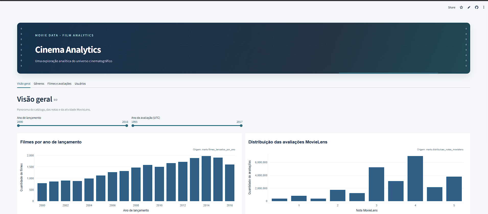
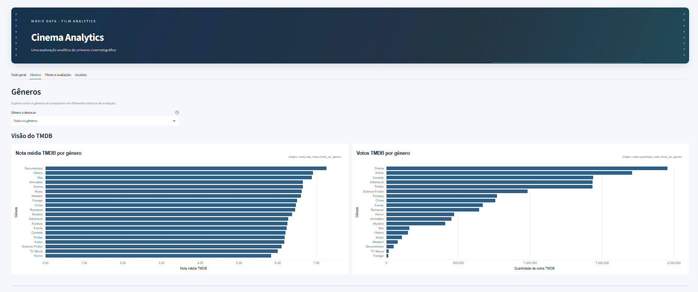
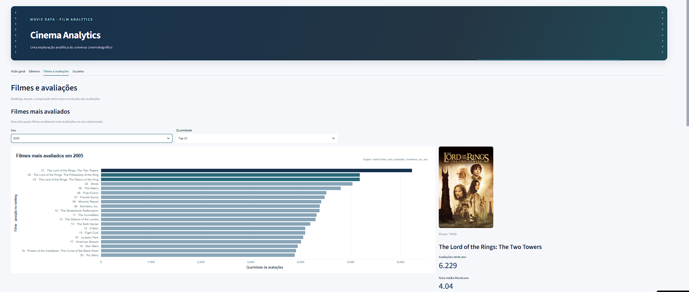
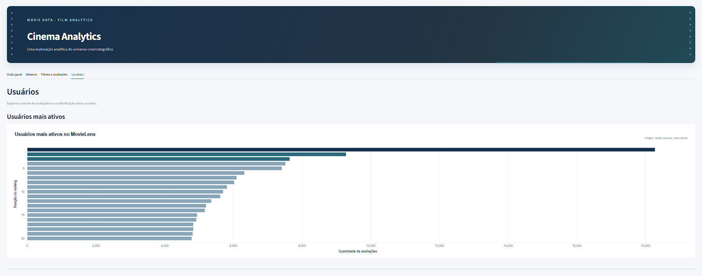

# Dashboard Streamlit

O dashboard `app.py` organiza a análise em quatro abas. O banco é selecionado por `pipeline/db.py` e validado em modo somente leitura antes da renderização.

## Visão geral

Apresenta filmes por ano de lançamento, distribuição das notas MovieLens, avaliações por ano UTC e nota média anual. Permite filtrar intervalos de anos de lançamento e de avaliação.

## Gêneros

Compara nota média e votos TMDB por gênero com nota média MovieLens por gênero. Um seletor destaca um gênero sem remover os demais da comparação.

## Filmes e avaliações

Apresenta ranking anual, destaque do filme mais avaliado no ano, ranking histórico, comparação entre anos e evolução das avaliações. O destaque pode mostrar pôster obtido do servidor de imagens TMDB; o aplicativo usa cache e fallback quando a imagem não está disponível.

## Usuários

Apresenta o ranking de usuários mais ativos, a distribuição por faixas de quantidade de avaliações e uma tabela detalhada.

As capturas são cópias de `assets/dashboard/`; os originais não são modificados.
