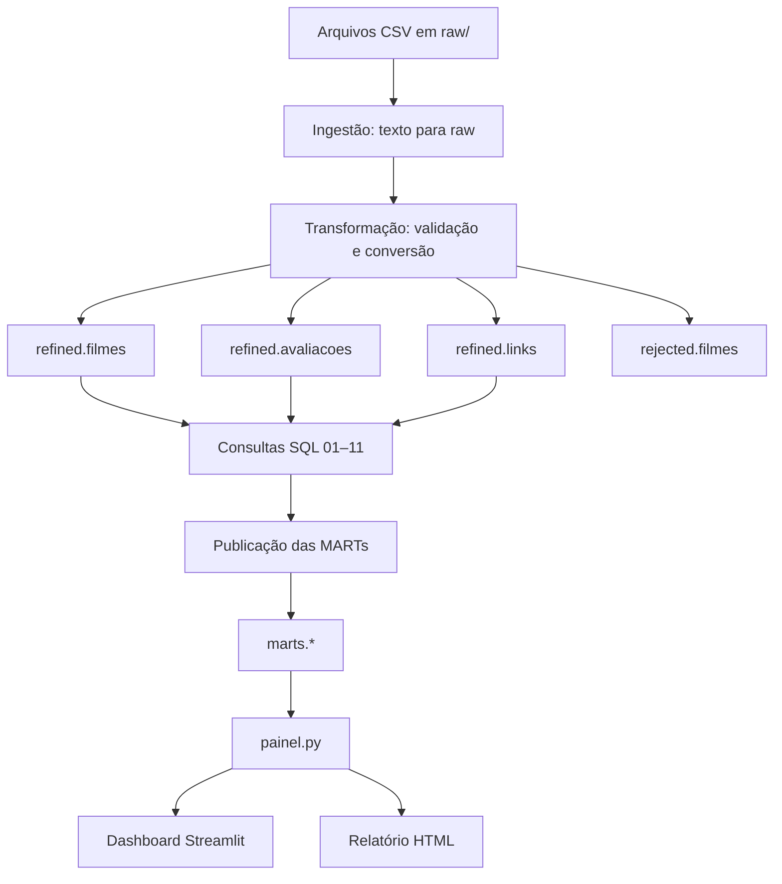

# Fluxo de dados

1. `pipeline.ingestao` valida os cinco arquivos CSV requeridos e os carrega no schema `raw` como texto.
2. `pipeline.transformacao` valida as tabelas `raw.filmes`, `raw.avaliacoes` e `raw.links`, converte tipos e publica as tabelas refined e os filmes rejeitados em uma transação.
3. `pipeline.marts` descobre os SQLs numerados em `sql/marts/`, executa as consultas e cria as tabelas `marts` em uma transação. Também permite selecionar indicadores com `--only`.
4. `painel.py` consulta as MARTs para alimentar `app.py` e `relatorio.py`.

As tabelas `raw.creditos` e `raw.palavras_chave` são ingeridas, mas estão fora da transformação refined documentada.
