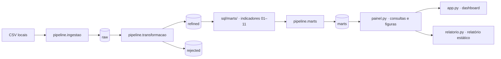

# Visão geral da arquitetura

O projeto separa a ingestão dos arquivos de origem, a validação e conversão dos dados, a publicação de indicadores analíticos e sua apresentação. A arquitetura usa schemas do DuckDB como camadas lógicas.

O executor `pipeline.marts` lê os arquivos SQL e cria uma tabela por consulta no schema `marts`. O `painel.py` consulta as MARTs em modo somente leitura e fornece os dados e figuras ao dashboard Streamlit e ao gerador do relatório HTML.

## Páginas relacionadas

- [Fluxo de dados](fluxo-dados.md)
- [Camadas](camadas.md)
- [Módulos Python](modulos.md)
- [Indicadores](../indicadores/index.md)
