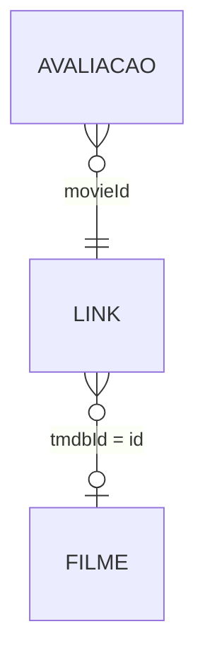

# Granularidade e relacionamentos

As descrições abaixo seguem a especificação de transformação, as evidências e os comentários das consultas SQL. O projeto não declara constraints formais de chave primária no DuckDB; as chaves citadas são regras de validação ou identificadores usados nos relacionamentos.

| Tabela | Granularidade | Chave/regra relevante |
|---|---|---|
| `raw.filmes` | Registro lido do CSV de metadados. | `id` pode repetir-se na origem. |
| `refined.filmes` | Filme aceito pelas regras de qualidade. | `id` é obrigatório; duplicatas integrais idênticas são reduzidas; ocorrências dos 13 IDs divergentes e três linhas malformadas são rejeitadas. |
| `raw.avaliacoes` / `refined.avaliacoes` | Uma avaliação de usuário para um `movieId`. | Par (`userId`, `movieId`) deve ser único; `timestamp` permanece Unix em segundos. |
| `raw.links` / `refined.links` | Um mapeamento por `movieId`. | `movieId` é único; `tmdbId` pode ser nulo e pode repetir-se entre `movieId`s. |
| `rejected.filmes` | Uma ocorrência rejeitada de `raw.filmes`. | Guarda os campos originais e metadados de rejeição. |

## Caminho dos relacionamentos

`refined.avaliacoes.movieId` relaciona-se a `refined.links.movieId`; `refined.links.tmdbId` pode relacionar-se a `refined.filmes.id`. O vínculo TMDB pode estar ausente, e diferentes `movieId`s podem apontar para o mesmo `tmdbId`. As consultas 07 e 11 mantêm avaliações sem metadado por meio de `LEFT JOIN`; a consulta 10 usa junções internas para a análise por gênero.

Filmes multigênero participam de cada gênero extraído. Por isso, contagens e votos por gênero não são aditivos entre grupos.
