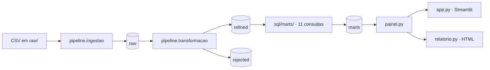

# Movie Data Pipeline

O **Cinema Analytics** é um projeto de Engenharia de Dados que transforma metadados de filmes e avaliações MovieLens em tabelas analíticas no DuckDB. O objetivo é explorar o catálogo, as avaliações registradas e a atividade observada dos usuários, preservando a distinção entre métricas TMDB e MovieLens.

## Dados e tecnologias

O conjunto de referência é [The Movies Dataset — Rounak Banik (Kaggle)](https://www.kaggle.com/datasets/rounakbanik/the-movies-dataset). Ele reúne arquivos com metadados de filmes, avaliações, créditos, palavras-chave e identificadores. O projeto utiliza Python, DuckDB, SQL, pandas, Plotly, Streamlit e uv; as dependências estão declaradas em `pyproject.toml` e resolvidas em `uv.lock`.

## Arquitetura em uma leitura

- **`raw`** guarda as tabelas carregadas dos CSVs como texto, sem conversões de tipos da etapa refined.
- **`refined`** contém filmes, avaliações e links tipados e validados.
- **`rejected`** preserva os registros de filmes isolados pelas regras de qualidade, com origem e motivo.
- **`marts`** contém as 11 tabelas analíticas criadas a partir dos SQLs versionados.

## Resultados documentados

As evidências existentes registram 45.420 filmes em `refined.filmes`, 26.024.289 avaliações em `refined.avaliacoes`, 45.843 links em `refined.links` e 29 registros em `rejected.filmes`. Esses números são resultados documentados em [Evidências da transformação](dados/evidencias.md), não uma execução realizada durante a escrita destas páginas.

## Acesse as aplicações

- [Dashboard interativo no Streamlit Community Cloud](https://movie-data-pipeline-aufci3bj3y77rd7rwijzbu.streamlit.app/)
- [Relatório HTML estático](https://robertrossi.github.io/movie-data-pipeline/relatorio.html) — quatro seções e 14 gráficos Plotly, sem filtros do dashboard.

## Navegação

- [Arquitetura e fluxo de dados](arquitetura/visao-geral.md)
- [Fontes, dicionário e modelagem](dados/fontes.md)
- [Os 11 indicadores de negócio](indicadores/index.md)
- [Instalação e execução](operacao/instalacao.md)
- [Testes e integração contínua](qualidade/testes.md)
- [Dashboard e relatório](aplicacoes/dashboard.md)
